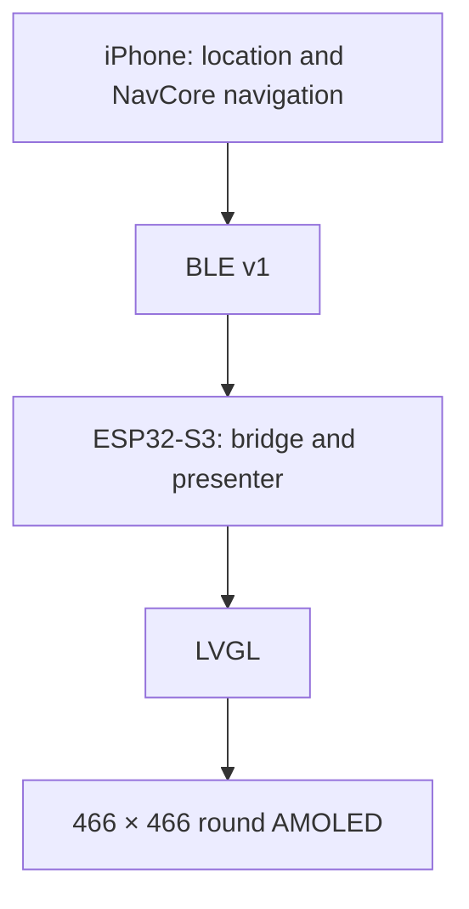
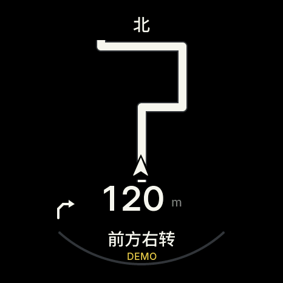

# Waymate

**Your Ride Companion**

A motorcycle navigation companion connecting an iPhone to a round AMOLED display.

[中文 / Full project introduction](README.md) · [RC2 release notes](FINAL_RELEASE_NOTES.md) · [Source publication audit](docs/final/GITHUB_SOURCE_RELEASE.md)

## Why I Built Waymate

I am a graduate student in cultural heritage and museum studies, with a non-computer-science background and an interest in product design, AI and software development.

Waymate started as a gift idea for someone who enjoys riding motorcycles: a device that could show useful navigation information without repeatedly checking a phone. Learning to connect an iPhone app, ESP32-S3, round AMOLED, BLE communication and navigation data gradually turned that idea into a physical device.

AI assisted the development process. The device itself does not perform AI inference.

## How It Works



The iPhone handles location, route-provider access, navigation computation and ride records. The display receives snapshots and route geometry over BLE. Live route planning requires your own HTTPS gateway; API keys stay on the server.

## Features & Status

| Feature | Implemented | Verification |
| --- | --- | --- |
| Navigation | Search, route preview, phone map and round-display route guidance | Software tests passed; RC2 live-route and display acceptance pending |
| Ride | Sessions, pause/resume, segmented tracks, history, sharing and GPX export | Software tests passed; road, background and lock-screen testing pending |
| Backtrack | Return guidance using the current active Ride's recorded track | Software tests passed; physical end-to-end road testing pending |
| Demo Mode | Simulated routes, 84-second playback, manual controls, phone preview and real BLE transport | Three Demo UI tests passed; earlier firmware drove a physical display; RC2 device acceptance pending |

**Final RC2: iOS 0.3.2 (8), ESP32 0.3.2-final-rc2. Ready for device testing.**

The publication checks passed 245 iOS unit tests, three Demo UI tests, 10 Native test groups, 19 Swift Package tests, 61 backend tests, seven Cloudflare tests, map integrity checks and a full ESP32 build. See the [source publication audit](docs/final/GITHUB_SOURCE_RELEASE.md).

Earlier installed firmware has real BLE connection, physical-display Demo and three cold-boot records. Those records do not establish acceptance of the latest RC2 firmware. RC2 installation and full device acceptance remain pending. Ride and Backtrack still need real road tests.

## Hardware & Stack

- Waveshare **ESP32-S3-Touch-AMOLED-1.75C**, 466 × 466 AMOLED, touch and onboard QMI8658.
- iPhone positioning and BLE communication; no external GPS module in the current device.
- Swift / SwiftUI, Core Location, CoreBluetooth, MapKit, C++17 / NavCore, ESP-IDF 5.5.5, NimBLE, LVGL 9.5.0 and a Node.js / Cloudflare gateway.

## Demo & Images

Open **More → Demo Mode** after ending active navigation, Ride and Backtrack sessions. Select a simulated route, play, pause, replay, step or jump between phases. Demo data stays separate from real history.

**Routes, positions, speed and tracks are simulated inputs.** A compatible physical display can receive them through a real BLE connection. Earlier firmware may not show the final DEMO corner label; keep the phone's simulation label visible when recording. Demo is not road-test evidence.



This is a software-rendered LVGL preview, not a device photograph. Existing iPhone simulator screenshots and honest placeholders for physical photos and video are in the [Chinese README](README.md#screenshots--videos).

## Getting Started

```sh
git clone --recurse-submodules https://github.com/ekitou7-design/Waymate.git
cd Waymate
brew install xcodegen
cd platforms/ios
xcodegen generate
open Waymate.xcodeproj
```

Use Xcode with Swift 6 support (validated with Xcode 16.4); iOS 17+ is required. Choose a simulator for Demo. For your own phone, select your signing Team in Xcode and configure an appropriate Bundle ID. Existing installations should retain their Bundle ID for data continuity. Live navigation needs your own [gateway configuration](docs/GATEWAY_SETUP.en.md); the default URL is a placeholder.

For ESP32, install ESP-IDF 5.5.5 and run from the repository root:

```sh
. /path/to/esp-idf-v5.5.5/export.sh
python3 scripts/rebind_lvgl_lock.py
idf.py -C platforms/esp32 -B build-esp32 build
```

LVGL is pinned as a Git submodule. ESP-IDF fetches managed dependencies from the lock file. Building does not flash a device. Before updating an already paired device, verify partitions, make and verify NVS and App backups, and follow the [App-only installation and rollback instructions](docs/final/INSTALL_AND_ROLLBACK.md).

See [software checks](docs/TESTING.en.md) and the [device acceptance checklist](docs/final/DEVICE_ACCEPTANCE.md).

## Roadmap

Complete RC2 boot, display and reconnect acceptance; test live Navigation, Ride and Backtrack on roads; improve readability and stability from observed results and add version-labelled physical photos and videos.

## About the Creator

**[ekitou7-design](https://github.com/ekitou7-design)** — a graduate student in cultural heritage and museum studies exploring product design through practical needs, AI-assisted development and hardware experiments.

## License & Credits

The existing [PolyForm Noncommercial 1.0.0](LICENSE.md) license is retained. Third-party materials keep their own licenses.

Waymate builds on **MOTO GPS – Waveshare Edition by Maler X**. The original Required Notices remain intact. Credits include ESP-IDF / NimBLE, LVGL, Waveshare BSP, Inter, Noto Sans SC / Source Han Sans SC, Montserrat and OpenStreetMap contributors. The route-first navigation layout takes inspiration from Beeline Moto II and uses the project's own rendering code and assets.

See [NOTICE](NOTICE), [third-party notices](THIRD_PARTY_NOTICES.en.md) and [LICENSES](LICENSES/).
