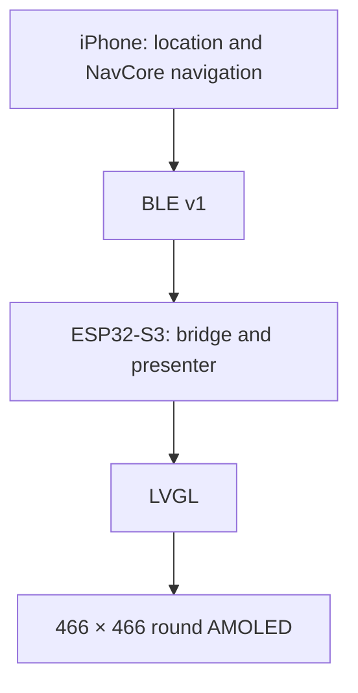

# Waymate

**Your Ride Companion**

A motorcycle navigation companion connecting an iPhone to a round AMOLED display.

[中文 / Full project introduction](README.md) · [RC2 release notes](FINAL_RELEASE_NOTES.md) · [Source publication audit](docs/final/GITHUB_SOURCE_RELEASE.md)

## How It Works



The iPhone handles location, route-provider access, navigation computation and ride records. The display receives snapshots and route geometry over BLE. Live route planning requires your own HTTPS gateway; API keys stay on the server.

## Features & Status

| Feature | Implemented | Verification |
| --- | --- | --- |
| Navigation | Search, route preview, phone map and round-display route guidance | Software tests passed; RC2 live-route and display acceptance pending |
| Ride | Sessions, pause/resume, segmented tracks, history, sharing and GPX export | Software tests passed; road, background and lock-screen testing pending |
| Backtrack | Return guidance using the current active Ride's recorded track | Software tests passed; physical end-to-end road testing pending |
| Demo Mode | Simulated routes, 84-second playback, manual controls, phone preview and real BLE transport | Three Demo UI tests passed; earlier firmware drove a physical display; RC2 device acceptance pending |

**Final RC2: iOS 0.3.2 (8), ESP32 0.3.2-final-rc2. Ready for device testing.**

The publication checks passed 245 iOS unit tests, three Demo UI tests, 10 Native test groups, 19 Swift Package tests, 61 backend tests, seven Cloudflare tests, map integrity checks and a full ESP32 build. See the [source publication audit](docs/final/GITHUB_SOURCE_RELEASE.md).

Earlier installed firmware has real BLE connection, physical-display Demo and three cold-boot records. Those records do not establish acceptance of the latest RC2 firmware. RC2 installation and full device acceptance remain pending. Ride and Backtrack still need real road tests.

## Hardware & Stack

- Waveshare **ESP32-S3-Touch-AMOLED-1.75C**, 466 × 466 AMOLED, touch and onboard QMI8658.
- iPhone positioning and BLE communication; no external GPS module in the current device.
- Swift / SwiftUI, Core Location, CoreBluetooth, MapKit, C++17 / NavCore, ESP-IDF 5.5.5, NimBLE, LVGL 9.5.0 and a Node.js / Cloudflare gateway.

## Demo & Images

Open **More → Demo Mode** after ending active navigation, Ride and Backtrack sessions. Select a simulated route, play, pause, replay, step or jump between phases. Demo data stays separate from real history.

**Routes, positions, speed and tracks are simulated inputs.** A compatible physical display can receive them through a real BLE connection. Earlier firmware may not show the final DEMO corner label; keep the phone's simulation label visible when recording. Demo is not road-test evidence.


This is a software-rendered LVGL preview, not a device photograph. Existing iPhone simulator screenshots and honest placeholders for physical photos and video are in the [Chinese README](README.md#screenshots--videos).

## Getting Started

Start with **phone Demo → your iPhone → physical display → live navigation**. You do not need the hardware or a navigation API key to try Demo.

| Goal | Requirements |
| --- | --- |
| Demo in a simulator | Mac, Xcode with Swift 6 support, XcodeGen |
| Run on your iPhone | iOS 17+, your Apple signing settings and a data cable |
| Use the physical display | Waveshare 1.75C board, ESP-IDF 5.5.5 and a real iPhone for BLE |
| Live search and navigation | Location access, connectivity, your own HTTPS gateway and AMap Web Service key |

The repository contains source, not a universally installable signed App. There is no ready-to-use Android App or public free navigation gateway.

### 1. Prepare the Mac and download the source

Install [Xcode](https://developer.apple.com/xcode/), launch it once to complete component installation, and install [Homebrew](https://brew.sh/) if `brew` is unavailable. Xcode 16.4 was used for RC2 verification.

Open Terminal and run these commands one line at a time:

```sh
brew install xcodegen
xcodebuild -version
xcodegen --version
cd ~
git clone --recurse-submodules https://github.com/ekitou7-design/Waymate.git
cd ~/Waymate
```

The clone includes pinned LVGL source. Do not clone again into an existing directory; use your existing checkout instead. GitHub's ordinary source ZIP does not include submodules. To fetch a missing submodule, run `git submodule update --init --recursive` from the repository root.

### 2. Run Demo in a simulator

```sh
cd ~/Waymate/platforms/ios
xcodegen generate
open Waymate.xcodeproj
```

Choose the **Waymate** scheme and an **iPhone simulator**, then click Run or press `⌘R`. Install an iOS simulator runtime in Xcode Settings → Components / Platforms if none is available. Open **More → Demo Mode**, select a route and press Start.

A phone display preview labelled **DEMO / simulation**, with changing route, distance and phases, confirms your first software run. No signing Team or gateway is needed for this path. A simulator cannot validate physical BLE.

### 3. Run on your iPhone

Add your Apple account in Xcode Settings → Accounts. Connect and trust the phone, enable Developer Mode when prompted, and select the phone as the run destination.

New installations should set unique App and test `PRODUCT_BUNDLE_IDENTIFIER` values in `platforms/ios/project.yml`, then regenerate the project. Existing installations should retain their Bundle ID to preserve data continuity. After generation, choose your own Team with automatic signing in the Waymate target's Signing & Capabilities. Click Run, grant location and Bluetooth permissions as needed, and try Demo first. See [iPhone setup](platforms/ios/README.en.md).

### 4. Build the physical display firmware

Follow the [official ESP-IDF 5.5.5 installation guide](https://docs.espressif.com/projects/esp-idf/en/v5.5.5/esp32s3/get-started/index.html) for ESP32-S3. This example assumes the SDK is installed at `~/esp/esp-idf-v5.5.5`; adjust that path if needed:

```sh
. ~/esp/esp-idf-v5.5.5/export.sh
idf.py --version
cd ~/Waymate
python3 scripts/rebind_lvgl_lock.py
idf.py -C platforms/esp32 -B build-esp32 build
```

Expect `Project build complete` and `build-esp32/moto_gps_esp32.bin`. Managed dependencies are downloaded from the lock file. Building does not install firmware.

Read the [Waveshare DIY guide](docs/WAVESHARE_DIY_GUIDE.en.md) before your first installation. For an existing paired device, verify partitions and current NVS/App backups before an App-only update. The [installation and rollback record](docs/final/INSTALL_AND_ROLLBACK.md) describes a local delivery; its private signed App and device-specific scripts are not supplied in this public repository. Do not copy its personal device paths or blindly use the build log's full-flash command.

After installation, boot normally and connect from the App's display entry. Confirm real BLE/Ready status before Demo. A real iPhone is required for physical BLE; the devices do not need a shared Wi-Fi network. Earlier firmware does not prove the RC2 UI is installed.

### 5. Configure live navigation

Deploy your own [Node.js gateway](docs/GATEWAY_SETUP.en.md) or [Cloudflare Workers + R2 gateway](backend/cloudflare/README.en.md). Store your **AMap Web Service key on the server**.

Open gateway settings from the phone's home-screen gear, enter your HTTPS base address, test the connection and save. `example.invalid` is a placeholder. Verify actual search and route requests while stationary before testing movement. Ordinary driving routes have not been fully validated for motorcycle restrictions.

### 6. Optional software checks

Development checks need CMake, a C++ compiler and Node.js 24+ in addition to Xcode. Run from the repository root:

```sh
cd ~/Waymate
cmake -S . -B build/native -DMOTO_BUILD_WEB=OFF -DMOTO_BUILD_TESTS=ON
cmake --build build/native --parallel 4
ctest --test-dir build/native --output-on-failure
npm ci --prefix backend
npm --prefix backend test
swift test --package-path platforms/ios
```

These checks do not flash hardware or require live API keys. See [testing](docs/TESTING.en.md) and the [device acceptance checklist](docs/final/DEVICE_ACCEPTANCE.md).

## FAQ

| Problem | First check |
| --- | --- |
| No display hardware | Try Demo using the phone preview. |
| `brew` or `xcodegen` not found | Complete Homebrew environment setup, then install XcodeGen. |
| Missing Xcode project | Run `xcodegen generate` in `platforms/ios`. |
| Missing LVGL | Initialize Git submodules from the repository root. |
| Xcode asks for a Team | Choose a simulator for software Demo, or your own signing Team for a phone. |
| `idf.py` not found | Enable the installed ESP-IDF 5.5.5 environment in the current terminal. |
| Destination search fails | Replace the placeholder gateway; check HTTPS, paths, server, key and quota. |
| Simulator does not connect to BLE | Use a real iPhone and grant Bluetooth access. |
| Downloaded maps but no offline route planning | Downloads are road/building backgrounds, not offline search or rerouting. |

See the [full project directory index](README.md#project-structure) and [usage flows](README.md#使用流程).

## Roadmap

Complete RC2 boot, display and reconnect acceptance; test live Navigation, Ride and Backtrack on roads; improve readability and stability from observed results and add version-labelled physical photos and videos.

## License & Credits

The existing [PolyForm Noncommercial 1.0.0](LICENSE.md) license is retained. Third-party materials keep their own licenses.

Waymate builds on **MOTO GPS – Waveshare Edition by Maler X**. The original Required Notices remain intact. Credits include ESP-IDF / NimBLE, LVGL, Waveshare BSP, Inter, Noto Sans SC / Source Han Sans SC, Montserrat and OpenStreetMap contributors. The route-first navigation layout takes inspiration from Beeline Moto II and uses the project's own rendering code and assets.

See [NOTICE](NOTICE), [third-party notices](THIRD_PARTY_NOTICES.en.md) and [LICENSES](LICENSES/).
