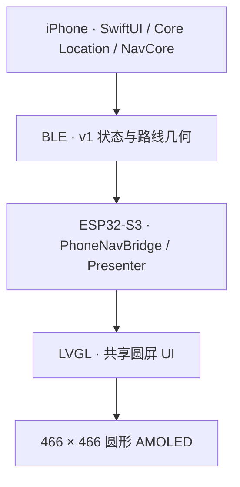
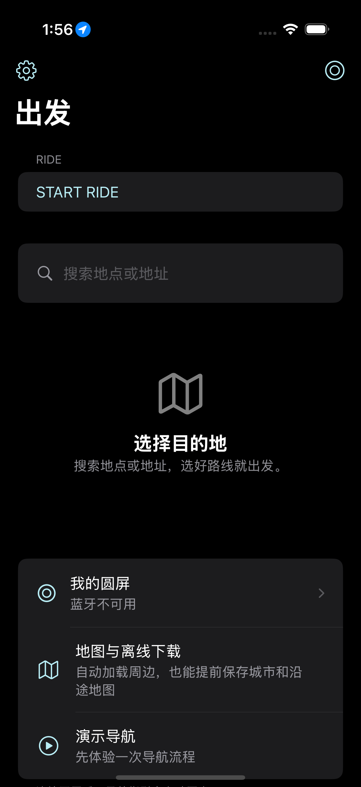

<div align="center">
  
  <h1>Waymate</h1>
  <p><strong>Your Ride Companion</strong></p>
  <p>一款连接 iPhone 与圆形 AMOLED 屏幕的摩托车骑行导航伴侣。</p>
  <p><a href="#demo">Demo</a> · <a href="#getting-started">Getting Started</a> · <a href="FINAL_RELEASE_NOTES.md">RC2 发布记录</a></p>
  <p> </p>
</div>

[English introduction](README.en.md)

## Why I Built Waymate

我是一名文物与博物馆学专业的研究生，并非计算机专业出身，但一直对产品设计、AI 和软件开发很感兴趣。

Waymate 最初来自一个简单的想法：为喜欢骑摩托车的人，制作一份真正可以使用的礼物。我希望骑行时不用频繁查看手机，也能方便地获得导航信息。于是从 iPhone App、ESP32-S3 和圆形 AMOLED 开始，逐步尝试 BLE 通信、导航数据处理与硬件交互，把想法做成真实设备。

开发过程中，AI 帮助我理解代码、实现功能和排查问题。Waymate 的导航与显示由软件和硬件协作完成；设备本身没有 AI 推理功能。

## What Is Waymate?

手机保留完整地图、路线规划和骑行记录；车把上的圆屏集中显示路线、当前位置、下一步动作及距离。

- **iPhone** 负责地点搜索、路线规划接入、定位和共享 NavCore 导航计算。
- **BLE** 将导航与骑行状态同步到设备，并回传圆屏操作。
- **ESP32-S3** 接收数据，通过 LVGL 在圆形 AMOLED 上显示。

圆屏以黑底和清楚的白色路线呈现前方路径。路线视野随路口距离变化；方位不确定时显示“沿路线前进”。周边道路只使用已有数据，缺少数据时留空。

## Features

| 功能 | 已实现的内容 | 验证状态 |
| --- | --- | --- |
| **Navigation** | 搜索与路线预览、实时导航、手机完整地图；圆屏微型路线图、当前位置、下一动作与距离 | 软件回归通过；RC2 真实路线及圆屏端到端验收待完成 |
| **Ride** | 骑行距离与时间、暂停／恢复、分段轨迹、History、分享与 GPX 导出 | 软件回归通过；真实道路、后台和锁屏测试待完成 |
| **Backtrack** | 从当前活动 Ride 的已记录轨迹建立返回指引，并同步圆屏 | 软件回归通过；真实道路返回与圆屏同步待完成 |
| **Demo Mode** | 模拟路线、84 秒流程播放、暂停／重播／下一步、阶段跳转、手机预览与真实 BLE 联动 | 3 项 Demo UI 测试通过；此前版本已驱动实体圆屏，RC2 最终固件验收待完成 |

“已实现”表示代码具备该功能；软件测试、历史硬件记录和当前 RC2 真机验收分别记录，不能相互替代。

## Hardware

| 部件 | 实际用途 |
| --- | --- |
| **Waveshare ESP32-S3-Touch-AMOLED-1.75C** | ESP32-S3、466 × 466 圆形 AMOLED 与触摸输入 |
| **板载 QMI8658** | 运动与航向融合的辅助输入；主导航视角不依赖设备原地朝向 |
| **BLE** | iPhone Central ↔ ESP32 Peripheral |
| **iPhone** | Core Location 定位、路线规划接入、导航计算与骑行记录 |

当前设备使用 iPhone 定位，没有外置 GPS 模块。仓库内的自研主板与制造资料属于历史工程探索，不是 RC2 的现用硬件。

## Architecture



正式路线搜索与规划通过自有 HTTPS 网关接入高德服务；导航状态由共享 C++ NavCore 处理。Demo 使用独立模拟会话，复用展示和 BLE 链路。手机圆屏预览由 SwiftUI 绘制，实体圆屏由 LVGL 绘制。

## Demo

在 iPhone 首页打开 **更多 → Demo Mode · 演示模式**。先结束正式 Navigation、Ride 和 Backtrack，再进入演示。

1. 选择模拟路线：右转后左转、左转、直行、连续弯道或掉头。
2. 点击开始，播放约 84 秒的 Navigation → Ride → Backtrack 流程。
3. 使用暂停、继续、重播、下一步或阶段跳转控制展示；退出后恢复正式模式。

**演示路线、位置、速度与轨迹均为模拟输入。** 不需要真实 GPS、联网或外出骑行，也不会写入真实 History。连接兼容的实体圆屏后，可通过真实 BLE 通信演示；连接状态来自实际蓝牙连接。

此前已通过实体圆屏联动演示。RC2 最新圆屏固件尚未完成设备安装和完整验收；旧固件可能不显示最终 `DEMO` 角标，录制时应持续保留手机模拟标识。Demo 不作为真实道路导航、Ride 或 Backtrack 验收证据。见 [录制指南](docs/final/RECORDING_GUIDE.md)。

## Screenshots & Videos

下方手机图片是已有 App 模拟器截图；圆屏图片是最终 Presenter → LVGL 的 **466 × 466 软件渲染、模拟输入**，均不是实体设备实拍。

<table>
  <tr>
    <td align="center"><br>iPhone 首页 · 模拟器</td>
    <td align="center"><br>连续弯道 · LVGL 软件渲染</td>
  </tr>
</table>

更多 [导航场景预览](assets/previews/navigation/)。

| 实拍展示位置 | 当前素材状态 |
| --- | --- |
| 实体圆屏照片 | 待补充可公开的实拍，并注明安装固件版本 |
| 手机与圆屏 Demo 视频 | 待补充真实 BLE 演示视频，持续标明模拟输入 |
| Ride / Backtrack 道路记录 | 完成真实道路测试后补充 |

## Tech Stack

| 层 | 技术 |
| --- | --- |
| iPhone App | Swift、SwiftUI、Core Location、CoreBluetooth、MapKit；iOS 17+ |
| 共享导航 | C++17、NavCore / NavApp、坐标处理与 BLE v1 协议 |
| 圆屏固件 | ESP-IDF 5.5.5、C++、NimBLE、Waveshare BSP、LVGL 9.5.0 |
| 导航网关 | Node.js、Cloudflare Workers、服务端高德数据转换 |
| 开发与验证 | CMake / CTest、Swift Package、XCTest、XcodeGen；Web 预览使用 Emscripten |

## Development Status

**Waymate Final RC2：iOS 0.3.2 (8) · ESP32 0.3.2-final-rc2 · READY FOR DEVICE TESTING。**

RC2 交付记录中的软件验证：

| 检查 | 已有结果 |
| --- | --- |
| iOS 单元测试 | 245 项通过 |
| Demo UI 测试 | 3 项通过 |
| Native CTest | 10 组通过 |
| Swift Package | 19 项通过 |
| ESP32 完整隔离构建 | 通过 |

完整范围见 [FINAL_RELEASE_NOTES.md](FINAL_RELEASE_NOTES.md)；本次 GitHub 整理的复验见 [源码发布核验](docs/final/GITHUB_SOURCE_RELEASE.md)。

已有真实硬件记录包括手机与实体圆屏 BLE 连接成功、Demo Mode 驱动实体圆屏，以及此前 Display Startup Experiment 连续三次冷启动通过。**这些结果属于此前已安装版本，不能算作 RC2 最新圆屏固件已通过验收。**

RC2 尚需安装后验证启动与显示、BLE 重连、运行时内存、真实 GNSS 与路口推进。Ride 和 Backtrack 真实道路测试仍待完成。验收项目见 [DEVICE_ACCEPTANCE.md](docs/final/DEVICE_ACCEPTANCE.md)。ANCS 和 Stage 9B PSRAM 实验不属于本候选。

## Getting Started

### 获取源码

```sh
git clone --recurse-submodules https://github.com/ekitou7-design/Waymate.git
cd Waymate
```

LVGL 以锁定的 Git 子模块保存；ESP-IDF 托管依赖由组件管理器按 `dependencies.lock` 获取。编译缓存、私人签名和设备备份不随源码发布。

### iPhone App

需要 macOS、提供 Swift 6 的 Xcode（本候选使用 Xcode 16.4）及 XcodeGen。

```sh
brew install xcodegen
cd platforms/ios
xcodegen generate
open Waymate.xcodeproj
```

选择 iPhone 模拟器即可运行 Demo。安装到自己的 iPhone 时，在 Xcode 的 Signing & Capabilities 中选择自己的 Team；新用户设置自己的 Bundle ID，已有安装用户保留原 Bundle ID 以维护数据连续性。

正式搜索与导航需要配置自己的 HTTPS 导航网关；默认 `example.invalid` 是占位地址。密钥保留在服务端，Demo 无需网关。见 [iOS 设置](platforms/ios/README.md) 与 [网关设置](docs/GATEWAY_SETUP.md)。

### ESP32 固件

安装并启用 **ESP-IDF 5.5.5**。以下命令在仓库根目录执行；将 SDK 路径改为自己的安装位置。

```sh
. /path/to/esp-idf-v5.5.5/export.sh
python3 scripts/rebind_lvgl_lock.py
idf.py -C platforms/esp32 -B build-esp32 build
```

重绑定脚本只调整锁文件的本地 LVGL 路径，不改变依赖版本。构建完成不会自动安装。对已配对设备，安装前应核验分区、双读并校验 NVS、备份并验证当前完整 App；按 [安装与回退说明](docs/final/INSTALL_AND_ROLLBACK.md) 仅写入核实后的 App 分区，保留 NVS 与配对数据。硬件入门见 [Waveshare DIY 指南](docs/WAVESHARE_DIY_GUIDE.md)。

### 本地软件检查

```sh
cmake -S . -B build/native -DMOTO_BUILD_WEB=OFF -DMOTO_BUILD_TESTS=ON
cmake --build build/native --parallel 4
ctest --test-dir build/native --output-on-failure
npm ci --prefix backend
npm --prefix backend test
swift test --package-path platforms/ios
```

这些检查不刷写设备，也不需要真实导航 API Key。更多检查见 [TESTING.md](docs/TESTING.md)。

### 目录索引

| 目录 | 内容 |
| --- | --- |
| `platforms/ios` / `platforms/esp32` | iPhone App 与现用圆屏固件 |
| `shared` | NavCore、NavApp、Presenter、LVGL UI、协议与数据资源 |
| `backend` | 导航网关与服务端配置示例 |
| `tests` / `scripts` | 软件验证、构建与资源工具 |
| `assets` / `docs/final` | 展示素材、RC2 发布与验收记录 |
| `hardware` / `docs` | 历史硬件设计、技术资料与阶段记录 |

## Roadmap

- 完成 RC2 安装、冷启动、显示与 BLE 重连验收。
- 完成真实 Navigation、Ride 和 Backtrack 道路测试，核验锁屏和后台行为。
- 根据实测改善信息可读性与稳定性，补充带版本说明的实拍和视频。

## About the Creator

**[ekitou7-design](https://github.com/ekitou7-design)** · 文物与博物馆学研究生。

我喜欢从实际需求出发探索产品设计。Waymate 是我把设计兴趣、AI 辅助开发和硬件实践结合起来的一次尝试，也是那份骑行礼物逐渐成形的过程。

## License & Credits

项目沿用现有 [PolyForm Noncommercial 1.0.0](LICENSE.md)。使用和分发请遵守其非商业条款；第三方代码、字体与地图数据分别适用各自许可。本次整理未新增或替换许可证。

Waymate 基于 Maler X 的 **MOTO GPS – Waveshare Edition** 开发，保留原作者 Required Notice。感谢 ESP-IDF / NimBLE、LVGL、Waveshare BSP、Inter、Noto Sans SC / Source Han Sans SC、Montserrat 和 OpenStreetMap contributors。导航布局参考 Beeline Moto II 的路线优先思路，使用项目自己的绘制代码与资源。

归属及许可见 [NOTICE](NOTICE)、[第三方声明](THIRD_PARTY_NOTICES.md) 和 [LICENSES](LICENSES/)。高德和 Apple 平台服务遵循各自提供方条款。
