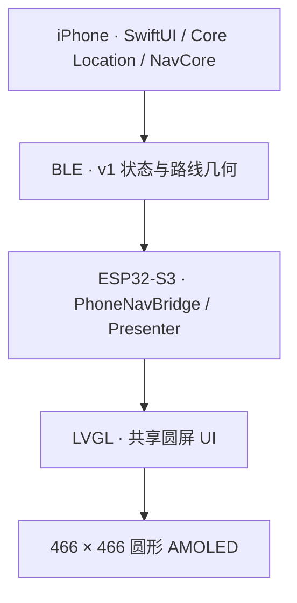

<div align="center">
  
  <h1>Waymate</h1>
  <p><strong>Your Ride Companion</strong></p>
  <p>一款连接 iPhone 与圆形 AMOLED 屏幕的摩托车骑行导航伴侣。</p>
  <p><a href="#demo">Demo</a> · <a href="#getting-started">Getting Started</a> · <a href="FINAL_RELEASE_NOTES.md">RC2 发布记录</a></p>
  <p> </p>
</div>

[English](README.en.md) · [功能](#features) · [快速上手](#getting-started) · [常见问题](#faq)

## What Is Waymate?

手机保留完整地图、路线规划和骑行记录；车把上的圆屏集中显示路线、当前位置、下一步动作及距离。

- **iPhone** 负责地点搜索、路线规划接入、定位和共享 NavCore 导航计算。
- **BLE** 将导航与骑行状态同步到设备，并回传圆屏操作。
- **ESP32-S3** 接收数据，通过 LVGL 在圆形 AMOLED 上显示。

项目包含 iPhone App、ESP32 固件、共享导航与显示代码、导航网关和软件测试。无需购买硬件即可先在 iPhone 模拟器中体验 Demo；实体圆屏通过 BLE 接入同一展示流程。

圆屏以黑底和清楚的白色路线呈现前方路径。路线视野随路口距离变化；方位不确定时显示“沿路线前进”。周边道路只使用已有数据，缺少数据时留空。

## Features

| 功能 | 已实现的内容 | 验证状态 |
| --- | --- | --- |
| **Navigation** | 搜索与路线预览、实时导航、手机完整地图；圆屏微型路线图、当前位置、下一动作与距离 | 软件回归通过；RC2 真实路线及圆屏端到端验收待完成 |
| **Ride** | 骑行距离与时间、暂停／恢复、分段轨迹、History、分享与 GPX 导出 | 软件回归通过；真实道路、后台和锁屏测试待完成 |
| **Backtrack** | 从当前活动 Ride 的已记录轨迹建立返回指引，并同步圆屏 | 软件回归通过；真实道路返回与圆屏同步待完成 |
| **Demo Mode** | 模拟路线、84 秒流程播放、暂停／重播／下一步、阶段跳转、手机预览与真实 BLE 联动 | 3 项 Demo UI 测试通过；此前版本已驱动实体圆屏，RC2 最终固件验收待完成 |

配套功能还包括城市／路线周边地图下载、离线背景缓存，以及授权后的 Apple Music 上一首、播放／暂停和下一首控制。离线地图只提供道路／建筑背景，不能替代联网地点搜索、路线规划和偏航重算；音乐页遥控手机播放器，不传输音频。具体操作见 [使用说明](docs/USER_MANUAL.md)。

“已实现”表示代码具备该功能；软件测试、历史硬件记录和当前 RC2 真机验收分别记录，不能相互替代。

## Hardware

| 部件 | 实际用途 |
| --- | --- |
| **Waveshare ESP32-S3-Touch-AMOLED-1.75C** | ESP32-S3、466 × 466 圆形 AMOLED 与触摸输入 |
| **板载 QMI8658** | 运动与航向融合的辅助输入；主导航视角不依赖设备原地朝向 |
| **BLE** | iPhone Central ↔ ESP32 Peripheral |
| **iPhone** | Core Location 定位、路线规划接入、导航计算与骑行记录 |

当前设备使用 iPhone 定位，没有外置 GPS 模块。仓库内的自研主板与制造资料属于历史工程探索，不是 RC2 的现用硬件。

## Architecture



正式路线搜索与规划通过自有 HTTPS 网关接入高德服务；导航状态由共享 C++ NavCore 处理。Demo 使用独立模拟会话，复用展示和 BLE 链路。手机圆屏预览由 SwiftUI 绘制，实体圆屏由 LVGL 绘制。

## 使用流程

| 模式 | 从哪里开始 | 如何结束 |
| --- | --- | --- |
| Navigation | 首页搜索目的地 → 选择地点 → 查看并选择路线 → 开始导航 | 在导航界面结束导航 |
| Ride | 首页 `START RIDE` → 查看距离、时间与轨迹；可用 `PAUSE` / `RESUME` 暂停或恢复 | `END RIDE` 后查看摘要、History 与分享 |
| Backtrack | 在仍然活动的 Ride 中，已有可用轨迹后启动原路返回 | `END BACKTRACK` 结束返回指导；Ride 可继续记录 |
| Demo Mode | 首页“更多”中进入演示模式 | “退出演示”恢复正式模式 |

Backtrack 沿本次 Ride 已记录的轨迹提供返回指导，不是重新规划一条路线，也不能从 History 中直接启动。轨迹断点不会被补成连续道路；圆屏指导需要设备声明 Backtrack 支持。

## Demo

在 iPhone 首页打开 **更多 → Demo Mode · 演示模式**。先结束正式 Navigation、Ride 和 Backtrack，再进入演示。

1. 选择模拟路线：右转后左转、左转、直行、连续弯道或掉头。
2. 点击开始，播放约 84 秒的 Navigation → Ride → Backtrack 流程。
3. 使用暂停、继续、重播、下一步或阶段跳转控制展示；退出后恢复正式模式。

**演示路线、位置、速度与轨迹均为模拟输入。** 不需要真实 GPS、联网或外出骑行，也不会写入真实 History。连接兼容的实体圆屏后，可通过真实 BLE 通信演示；连接状态来自实际蓝牙连接。

此前已通过实体圆屏联动演示。RC2 最新圆屏固件尚未完成设备安装和完整验收；旧固件可能不显示最终 `DEMO` 角标，录制时应持续保留手机模拟标识。Demo 不作为真实道路导航、Ride 或 Backtrack 验收证据。见 [录制指南](docs/final/RECORDING_GUIDE.md)。

## Screenshots & Videos

下方手机图片是已有 App 模拟器截图；圆屏图片是最终 Presenter → LVGL 的 **466 × 466 软件渲染、模拟输入**，均不是实体设备实拍。

<table>
  <tr>
    <td align="center"><br>iPhone 首页 · 模拟器</td>
    <td align="center"><br>连续弯道 · LVGL 软件渲染</td>
  </tr>
</table>

更多 [导航场景预览](assets/previews/navigation/)。

| 实拍展示位置 | 当前素材状态 |
| --- | --- |
| 实体圆屏照片 | 待补充可公开的实拍，并注明安装固件版本 |
| 手机与圆屏 Demo 视频 | 待补充真实 BLE 演示视频，持续标明模拟输入 |
| Ride / Backtrack 道路记录 | 完成真实道路测试后补充 |

## Tech Stack

| 层 | 技术 |
| --- | --- |
| iPhone App | Swift、SwiftUI、Core Location、CoreBluetooth、MapKit；iOS 17+ |
| 共享导航 | C++17、NavCore / NavApp、坐标处理与 BLE v1 协议 |
| 圆屏固件 | ESP-IDF 5.5.5、C++、NimBLE、Waveshare BSP、LVGL 9.5.0 |
| 导航网关 | Node.js、Cloudflare Workers、服务端高德数据转换 |
| 开发与验证 | CMake / CTest、Swift Package、XCTest、XcodeGen；Web 预览使用 Emscripten |

## Development Status

**Waymate Final RC2：iOS 0.3.2 (8) · ESP32 0.3.2-final-rc2 · READY FOR DEVICE TESTING。**

RC2 交付记录中的软件验证：

| 检查 | 已有结果 |
| --- | --- |
| iOS 单元测试 | 245 项通过 |
| Demo UI 测试 | 3 项通过 |
| Native CTest | 10 组通过 |
| Swift Package | 19 项通过 |
| ESP32 完整隔离构建 | 通过 |

完整范围见 [FINAL_RELEASE_NOTES.md](FINAL_RELEASE_NOTES.md)；本次 GitHub 整理的复验见 [源码发布核验](docs/final/GITHUB_SOURCE_RELEASE.md)。

已有真实硬件记录包括手机与实体圆屏 BLE 连接成功、Demo Mode 驱动实体圆屏，以及此前 Display Startup Experiment 连续三次冷启动通过。**这些结果属于此前已安装版本，不能算作 RC2 最新圆屏固件已通过验收。**

RC2 尚需安装后验证启动与显示、BLE 重连、运行时内存、真实 GNSS 与路口推进。Ride 和 Backtrack 真实道路测试仍待完成。验收项目见 [DEVICE_ACCEPTANCE.md](docs/final/DEVICE_ACCEPTANCE.md)。ANCS 和 Stage 9B PSRAM 实验不属于本候选。

## Getting Started

第一次接触项目，建议按“**手机 Demo → 自己的 iPhone → 实体圆屏 → 真实导航**”的顺序体验。先选需要的路径，不必一次安装全部工具。

| 你想做什么 | 需要准备 | 从哪里开始 |
| --- | --- | --- |
| 只看界面和模拟流程 | Mac、Xcode、XcodeGen | 下方第 1–3 步；无需圆屏或导航 Key |
| 在自己的 iPhone 上运行 | 上述工具、iPhone、自己的 Apple 签名设置 | 第 4 步 |
| 让实体圆屏接收信息 | Waveshare 1.75C 板、USB 数据线、ESP-IDF 5.5.5 | 第 5 步 |
| 搜索真实地点并导航 | 手机定位、联网、自己的 HTTPS 导航网关和高德 Web 服务 Key | 第 6 步 |

源码安装 iPhone App 需要 Mac；当前没有可直接使用的 Android App。仓库公开的是源码，不附带可供任意手机安装的签名 App，也没有公共免费导航网关。

### 1. 准备 Mac 上的工具

1. 从 [Apple 官方入口](https://developer.apple.com/xcode/)安装 Xcode，打开一次并完成首次组件安装。本候选已用 **Xcode 16.4** 验证；Swift Package 需要 Swift 6 工具链，App 最低支持 iOS 17。
2. 打开 macOS 的“终端”。如果还没有 `brew`，先按 [Homebrew 官方安装说明](https://brew.sh/)安装，并完成页面提示的环境配置。
3. 在终端安装生成 Xcode 工程的工具：

```sh
brew install xcodegen
xcodebuild -version
xcodegen --version
```

最后两条命令应打印版本。后续代码框都是终端命令，逐行执行；每步完成后再继续。

### 2. 下载完整源码

下面把项目下载到用户目录中的 `Waymate` 文件夹：

```sh
cd ~
git clone --recurse-submodules https://github.com/ekitou7-design/Waymate.git
cd ~/Waymate
```

`--recurse-submodules` 会同时下载锁定版本的 LVGL。首次下载需要联网。已下载项目的用户进入自己的仓库目录即可，不要在已有同名目录中重复克隆。如果漏了子模块，在仓库根目录补运行：

```sh
git submodule update --init --recursive
```

建议使用 Git 克隆，GitHub 的普通 ZIP 下载不包含子模块源码。后续示例默认项目位于 `~/Waymate`；若你放在其他位置，将命令中的路径改为实际目录。

### 3. 先在模拟器运行 Demo

```sh
cd ~/Waymate/platforms/ios
xcodegen generate
open Waymate.xcodeproj
```

1. 在 Xcode 顶部选择 **Waymate** scheme，运行目标选择一个 **iPhone 模拟器**。
2. 若没有可选模拟器，在 Xcode 的 Settings 的 Components / Platforms（名称随版本变化）中安装 iOS 模拟器运行时。
3. 点击左上角 **Run ▶**，或按 `⌘R`。首次构建需要等待依赖解析与编译。
4. App 打开后，进入 **更多 → Demo Mode · 演示模式**，选择路线并点击“开始”。

看到带有 **DEMO / 模拟演示** 标识的手机圆屏预览，且路线、距离与阶段随播放变化，就完成了首次体验。无需配置网关或签名 Team；模拟器不能验证实体 BLE 连接。

### 4. 安装到自己的 iPhone

1. 在 Xcode Settings → Accounts 添加自己的 Apple 账号。
2. 用数据线连接 iPhone，完成手机上的“信任此电脑”；按 Xcode 提示启用开发者模式。
3. 新安装用户在 `platforms/ios/project.yml` 中将 App 和两个测试 target 的 `PRODUCT_BUNDLE_IDENTIFIER` 换为自己可用的唯一标识，再运行 `xcodegen generate`。生成后的设置以该文件为来源；已有安装用户保留原 Bundle ID，避免破坏数据连续性。
4. 生成后，在工程的 Waymate target → Signing & Capabilities 中启用自动签名，选择自己的 Team，顶部运行目标改为自己的 iPhone。
5. 点击 Run。首次运行按功能需要允许定位、精确位置和蓝牙，然后先体验 Demo。

签名有效期与可用能力由自己的 Apple 账号决定；到期后需要重新签名构建。详细设置见 [iPhone App 文档](platforms/ios/README.md)。

### 5. 构建并准备实体圆屏

本项目面向 **Waveshare ESP32-S3-Touch-AMOLED-1.75C**，不是所有 ESP32 圆屏都能直接使用。

1. 按 [Espressif 官方 ESP-IDF 5.5.5 安装指南](https://docs.espressif.com/projects/esp-idf/en/v5.5.5/esp32s3/get-started/index.html)安装 ESP32-S3 工具链。
2. 启用 SDK 环境。以下示例假设 SDK 位于 `~/esp/esp-idf-v5.5.5`；如果不同，修改第一条命令。
3. 在仓库根目录构建：

```sh
. ~/esp/esp-idf-v5.5.5/export.sh
idf.py --version
cd ~/Waymate
python3 scripts/rebind_lvgl_lock.py
idf.py -C platforms/esp32 -B build-esp32 build
```

应看到 `Project build complete`，App 镜像位于 `build-esp32/moto_gps_esp32.bin`。组件管理器会按锁文件下载托管依赖；重绑定脚本只调整当前目录的 LVGL 路径。

**构建成功和实体安装是两个步骤。** 首次接触刷写时先阅读 [Waveshare DIY 指南](docs/WAVESHARE_DIY_GUIDE.md)；已有设备更新前按 [安装与回退记录](docs/final/INSTALL_AND_ROLLBACK.md) 核验分区、备份并校验 NVS 与完整 App，只写入核实后的 App 分区。该记录中的私人签名包和设备专用脚本不包含在公开仓库中，不能直接照抄其中设备路径。不要直接把构建日志的整套 flash 命令用于已配对设备。

固件安装后正常开机，打开手机 App 的圆屏连接入口，确认真实 BLE 连接及设备 Ready 状态，再进入 Demo。手机和圆屏无需处于同一个 Wi-Fi；实体联动需要真实 iPhone，不能用模拟器代替。旧固件的展示不代表 RC2 最终 UI 已部署。

### 6. 配置真实导航

Demo 可以离线运行；正式地点搜索与路线规划需要自己的服务。

1. 选择 [Node.js 自建网关教程](docs/GATEWAY_SETUP.md) 或 [Cloudflare Workers + R2 教程](backend/cloudflare/README.md)，部署自己的 HTTPS 网关。
2. 将自己的 **高德 Web 服务 Key** 配置在服务端；不要写入 iPhone App、固件或公开仓库。
3. 在手机首页左上角齿轮打开“网关设置”，输入自己的 HTTPS 根地址，点击“测试连接”并保存。默认 `example.invalid` 仅为占位地址。
4. 先在静止环境搜索附近地点、查看候选路线并开始导航，核对手机与圆屏信息。

网关连接成功还不等于高德 Key、权限、配额和路线请求全部有效；教程提供真实搜索检查。当前接入普通驾车路线，摩托车禁限行适配尚未完整验证。

### 7. 按需运行软件检查

开发者可在仓库根目录运行以下检查；只体验 Demo 不需要执行本节。C++ 检查需要 CMake 和编译器，后端及地图工具使用 Node.js 24+；Swift 工具链由 Xcode 提供。

```sh
cd ~/Waymate
cmake -S . -B build/native -DMOTO_BUILD_WEB=OFF -DMOTO_BUILD_TESTS=ON
cmake --build build/native --parallel 4
ctest --test-dir build/native --output-on-failure
npm ci --prefix backend
npm --prefix backend test
swift test --package-path platforms/ios
```

这些检查不刷写设备，也不需要真实导航 API Key。更多检查见 [TESTING.md](docs/TESTING.md)。

## FAQ

| 问题 | 先检查什么 |
| --- | --- |
| 没有圆屏，可以体验吗？ | 可以。在 iPhone 模拟器或自己的 iPhone 上运行 Demo，使用手机圆屏预览。 |
| `brew` / `xcodegen` 命令找不到 | 完成 Homebrew 安装后的环境配置，再运行 `brew install xcodegen`。 |
| 找不到 `Waymate.xcodeproj` | 先进入 `platforms/ios`，执行 `xcodegen generate`。工程由配置生成。 |
| LVGL 文件缺失 | 在仓库根目录执行 `git submodule update --init --recursive`；不要只下载普通 ZIP。 |
| Xcode 提示需要签名 Team | 模拟器体验选择 iPhone 模拟器；真机运行选择自己的 Team 和可用 Bundle ID。 |
| `idf.py` 命令找不到 | 在当前终端重新启用正确的 ESP-IDF `export.sh`，并确认版本为 5.5.5。 |
| 搜索失败或网关不可用 | 将占位地址改为自己可访问的 HTTPS 网关，检查服务运行、路径前缀、Key 与配额。 |
| 模拟器看不到实体圆屏 | 用真实 iPhone 测试 BLE，并允许蓝牙；模拟器仅验证软件界面。 |
| 下载地图后能完全离线导航吗？ | 不能。离线背景不提供地点搜索、新路线规划或偏航重算。 |

## Project Structure

| 目录 | 内容 |
| --- | --- |
| `platforms/ios` / `platforms/esp32` | iPhone App 与现用圆屏固件 |
| `shared` | NavCore、NavApp、Presenter、LVGL UI、协议与数据资源 |
| `backend` | Node.js / Cloudflare 导航网关与服务端配置示例 |
| `platforms/web` | 开发用 Web 调试与共享 UI 预览 |
| `tests` / `scripts` | 软件验证、构建与资源工具 |
| `assets` / `docs/final` | 展示素材、RC2 发布与验收记录 |
| `hardware` / `docs` | 历史硬件设计、技术资料与阶段记录 |

## Roadmap

- 完成 RC2 安装、冷启动、显示与 BLE 重连验收。
- 完成真实 Navigation、Ride 和 Backtrack 道路测试，核验锁屏和后台行为。
- 根据实测改善信息可读性与稳定性，补充带版本说明的实拍和视频。

## License & Credits

项目沿用现有 [PolyForm Noncommercial 1.0.0](LICENSE.md)。使用和分发请遵守其非商业条款；第三方代码、字体与地图数据分别适用各自许可。本次整理未新增或替换许可证。

Waymate 基于 Maler X 的 **MOTO GPS – Waveshare Edition** 开发，保留原作者 Required Notice。感谢 ESP-IDF / NimBLE、LVGL、Waveshare BSP、Inter、Noto Sans SC / Source Han Sans SC、Montserrat 和 OpenStreetMap contributors。导航布局参考 Beeline Moto II 的路线优先思路，使用项目自己的绘制代码与资源。

归属及许可见 [NOTICE](NOTICE)、[第三方声明](THIRD_PARTY_NOTICES.md) 和 [LICENSES](LICENSES/)。高德和 Apple 平台服务遵循各自提供方条款。
