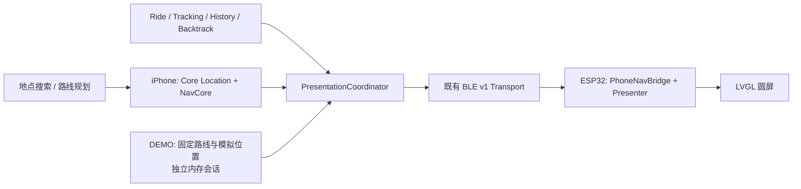

# Waymate

**把 iPhone 的导航能力，延伸到摩托车车把上的小圆屏。**

Waymate 是 iPhone + ESP32-S3 圆形 AMOLED 的骑行导航伴侣。手机负责搜索、规划与位置处理，圆屏通过 BLE 展示骑行时最需要快速识别的信息。比赛方向：**外挂大脑**。

## Why Waymate

手机适合看地图和规划路线；骑行中，一个清楚的方向、一个距离和下一步动作更容易快速识别。Waymate 将这部分信息放到车把上，同时保留手机上的完整路线与骑行记录。

导航以**中央微型路线图**为主：粗白路线呈现前方路口和连续弯道，箭头标记当前位置，下方集中显示下一动作距离和辅助转向。距离缩短时，路线视野连续聚焦。整体参考 Beeline Moto II 的路线优先布局，并保留 Waymate 的中文方位、手机协同和 DEMO 标识。

圆屏使用 NavCore 的真实路线几何及可用的周边道路，不补画虚构路口。地图朝上方向来自当前规划路段，不依赖设备原地旋转；方位不确定时显示“沿路线前进”。iPhone 正式导航保留完整底图、路线、当前位置、指令和路线总览。

## Features

| 能力 | 已实现 | 真实验证情况 |
| --- | --- | --- |
| Navigation | iPhone 搜索、路线预览、共享 NavCore；圆屏路线微型地图、当前位置箭头、下一动作距离与辅助方位 | 基础 BLE 导航显示有历史真机证据；完整真实路线、路口推进仍待验收 |
| Ride | 独立骑行会话、距离与时间、暂停／恢复、记录与分享 | 软件回归通过；真实骑行、后台与锁屏待验收 |
| Tracking | 原始 WGS84 轨迹；保留暂停／定位中断的分段 | 软件实现与测试；真实 GNSS 轨迹质量待验收 |
| Backtrack | 从当前 Ride 已记录轨迹建立返回指引，复用 BLE v1 既有扩展 | 软件回归通过；真实移动与圆屏端到端待验收 |
| BLE Display | 连接、状态同步、圆屏页面切换与中文显示 | 启动实验版已有连接和三次冷启动证据；本候选待真机验收 |
| Demo Mode | 固定 84 秒离线脚本、手动控制、手机圆屏预览、现有 BLE 联动 | **模拟输入的软件验证**；不等同于真实骑行或硬件验收 |

ANCS、Stage 9B PSRAM 内存实验和自研主板不属于本最终候选。

## Demo

在 iPhone 首页打开 **更多 → Demo Mode · 演示模式**。默认关闭；需先结束正式导航、Ride 和 Backtrack，避免演示替换真实会话。

- **开始／暂停／继续**：自动播放约 84 秒。
- **重播／下一步**：重复拍摄或逐步讲解。
- **Navigation／Ride／Backtrack**：快速跳转。
- **模拟路线选择**：右转后左转、左转、直行、连续弯道、掉头。
- **退出演示**：丢弃内存中的模拟数据，恢复正式模式。

默认演示使用一条虚构折线路径：向东 320 m → 右转向南 180 m → 左转向东 120 m。每个可选场景的导航、模拟轨迹和返回距离均来自该场景的同一套固定数据。路口方向不确定时，保守显示“沿路线前进”。模拟路线规划与预计剩余时间也属于演示输入。

**无需联网、真实 GPS 或外出骑行。** iPhone 展示“模拟圆屏 / DEMO PREVIEW”，其连接状态仍由真实 BLE 适配器提供。连接兼容圆屏后复用现有 NavigationSnapshot、RouteGeometry、BacktrackState 和 BacktrackGeometry；设备未声明 Backtrack 能力时请使用手机预览。

本候选用 v1 既有道路名称字段中的保留文本 `WAYMATE DEMO` 标记模拟输入。最终固件在圆屏上显示 `DEMO`，不更改 UUID、包结构、版本或能力位。旧固件能接收兼容数据，但未必显示新标记；使用旧固件录制时必须在画面中持续保留手机 DEMO 标识及模拟输入说明。

Demo 不写入真实 History、轨迹存储或用户偏好，不覆盖真实定位。它用于展示产品流程，不能作为真实 GNSS、道路、骑行或安全性能的验收证据。

## Hardware

- Waveshare **ESP32-S3-Touch-AMOLED-1.75C**：466 × 466 圆形 AMOLED、触摸。
- 板载 QMI8658：运动／航向融合的辅助输入；主导航方位不依赖设备朝向。
- iPhone：Core Location、路线规划、NavCore、Ride、Tracking、History、Backtrack。
- BLE：iPhone Central ↔ ESP32 Peripheral。

本候选使用手机定位，未把外置 GNSS 模块列为现有硬件能力。

## Architecture



正式导航和 Demo 分别拥有自己的 NavCore 输入与会话；它们复用协议、展示协调器及路线方位投影。手机预览展示同样的信息含义，具体渲染使用 SwiftUI；实体屏使用 LVGL。

## Quick Start

### iOS

使用能提供 Swift 6 的 Xcode（部署目标 iOS 17+）与 XcodeGen：

```sh
cd platforms/ios
xcodegen generate
open Waymate.xcodeproj
```

在 Xcode 中设置自己的签名及设备。正式搜索／规划需要配置自己的 HTTPS 导航网关；默认占位地址不可用于真实导航。Demo 不需要网关。详细操作见 [iPhone App](platforms/ios/README.md)、[网关设置](docs/GATEWAY_SETUP.md)。

### ESP32

本候选使用 ESP-IDF 5.5.5、LVGL 9.5.0 与锁定的 Waveshare 组件。Git 克隆先初始化下方子模块；源码发布包已包含 LVGL 和托管组件，可跳过子模块命令。

```sh
git submodule update --init --recursive
python3 scripts/rebind_lvgl_lock.py
. /path/to/esp-idf/export.sh
idf.py -C platforms/esp32 -B build-esp32 build
```

移动源码目录后，以上脚本只重绑定锁文件中的本地 LVGL 路径，不改变依赖版本，避免误用另一工作区。只构建不会安装。**已配对设备安装前必须读取真实分区表、双读并校验 NVS、备份并验证完整当前 App。** 按最终发布包中的手动安装说明，仅写经核实的 App 分区；禁止整片擦除、覆盖 NVS 或删除 Bond。不要把构建工具给出的默认整套 flash 命令直接用于已有设备。

正常开机圆屏后，在 iPhone 查看真实连接状态；无圆屏也可进入 Demo 预览。基础教程见 [微雪 DIY 指南](docs/WAVESHARE_DIY_GUIDE.md)。

## Screenshots / Demo Video

以下为最终 Presenter → LVGL 的 **466 × 466 软件渲染，模拟输入**；不是实体设备照片。其他预览见 [导航预览](assets/previews/navigation/)。


真实比赛视频与本候选实机照片将在完成录制后补充。Demo 录制全程保留模拟标识；不将软件渲染或模拟器截图当作真实道路验收。

## Current Status

**0.3.2 Final RC2 / iOS build 8 · READY FOR DEVICE TESTING**，为比赛录制准备的功能冻结候选。

- 软件构建、导航／Ride／Backtrack 回归及 Demo 隔离验证见 [FINAL_RELEASE_NOTES.md](FINAL_RELEASE_NOTES.md)。
- 用户报告此前 **Display Startup Experiment** 已正常启动、BLE 连接后显示正常、连续三次冷启动成功。该证据属于此前已安装版本。
- 此后的 `Waymate_RC_Cardinal_Display.bin` 及本候选均不能据此认定已安装或通过真机验收。
- 本候选保留启动 DMA 排空、BLE 初始化时序和 NVS 不自动擦除修复。真实显示、运行时内存、重连、GNSS、Ride 和 Backtrack 仍需在本候选上验收。
- 正式高德路线链路需要有效网关；摩托车禁限行适配尚未得到完整验证。

## Roadmap

比赛前停止计划性功能扩展，仅处理阻断演示或稳定性的问题。后续重点为真实路线／骑行／原路返回验收、锁屏与连接稳定性、道路适用性验证。

## License

项目原创部分沿用仓库现有 [PolyForm Noncommercial 1.0.0](LICENSE.md)，并非任意商业用途授权。第三方代码、字体与地图数据保持各自许可。请保留 [NOTICE](NOTICE)、[第三方声明](THIRD_PARTY_NOTICES.md) 及 [LICENSES](LICENSES/)。

## Credits

基于 Maler X 的 MOTO GPS – Waveshare Edition；保留原作者 Required Notice。感谢 LVGL、ESP-IDF／NimBLE、Waveshare BSP、Inter、Noto Sans SC／Source Han Sans SC、Montserrat 和 OpenStreetMap contributors。高德与 Apple 平台服务分别遵循其提供方条件，Waymate 不代表其官方产品或背书。详细归属和许可见 [第三方声明](THIRD_PARTY_NOTICES.md)。
